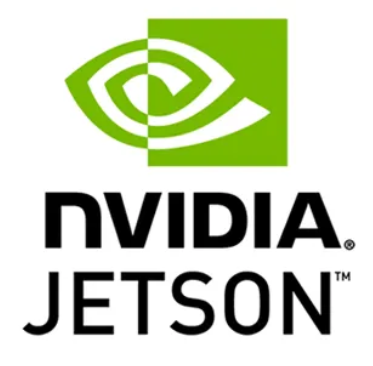
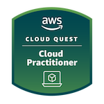
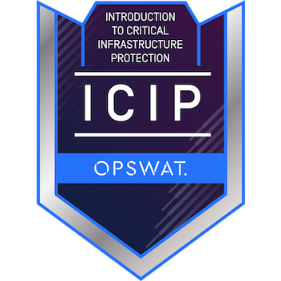

<h1 align="center">Hey  I'm Deepesh Patil</h1>
 

<h2 align="center">
  <a href="https://deepesh-patil.vercel.app/">Portfolio</a> •
  <a href="https://deepesh611.vercel.app/">GitHub Analytics</a>
</h2>

## 📌 About Me
An AI Engineer and IIIT Pune graduate. I build AI and data systems, with experience in **GenAI evaluation and observability, synthetic data generation, and Databricks**. I’m also interested in the platforms behind reliable software, including **DevOps, cloud infrastructure, and systems administration**.

### What I work with

- **AI & Data:** Python, PySpark, SQL, Databricks, MLflow, Langfuse
- **Application Development:** FastAPI, Flask, React, TypeScript
- **Platform & Infrastructure:** Docker, Kubernetes, Terraform, AWS, CI/CD
- **Other interests:** Linux, networking, and system administration

### Outside of work

- 🏍️ Riding
- 🎮 Gaming

---

## 📊 GitHub Stats

  
  

  

  

---
<!--
## 🧰 Technologies

### Languages

### Web & Backend

### Cloud, DevOps & Tools

---

## 🔧 Hardware & Systems

  
  
  

---
-->

## 🏅 Certifications & Badges

   

  
  
  
  
  
  
  
  

    

  

    

  

---

## 📫 Connect

[][instagram]
[][linkedin]

   

  
  

---

[instagram]: https://www.instagram.com/_deepesh_v.p/?next=%2F
[linkedin]: https://www.linkedin.com/in/deepesh-patil/
